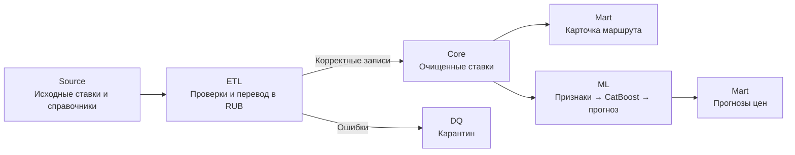
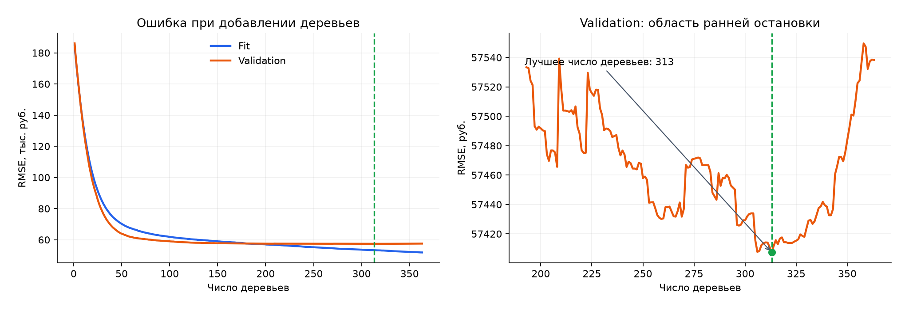
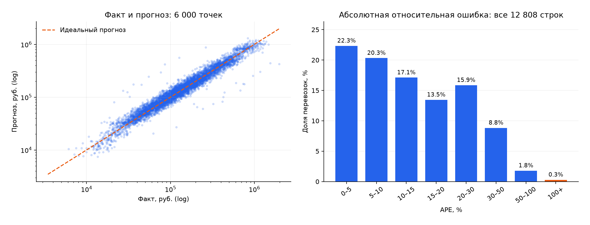
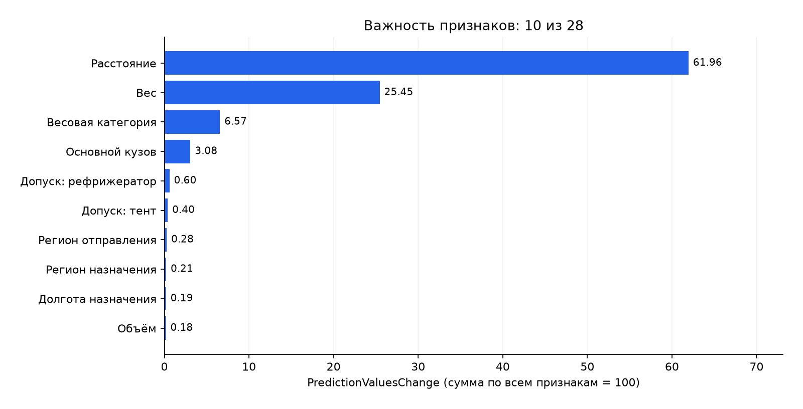

# Smart Logistics — Data & ML Platform

Учебный сквозной проект по инженерии данных: очистка транспортных ставок, аналитическая витрина рыночного коридора и прогноз тарифа за рейс. Источник — **300 000 синтетических записей**, хранилище — **PostgreSQL 17**, модель — **CatBoostRegressor**.

**Один запуск:** источник → Data Quality → Core → Mart → признаки → обучение → прогнозы в PostgreSQL. Airflow, Superset и ClickHouse относятся к необязательной части и не используются.

[Запуск](#быстрый-запуск) · [Архитектура](#архитектура) · [Пайплайны](#пайплайны) · [ML](#ml-и-результаты) · [SQL](#sql-для-проверки-витрин) · [Тесты](#тесты-и-проверка-требований) · [Ограничения](#ограничения)

## Быстрый запуск

Нужны Docker Engine / Docker Desktop с Linux-контейнерами и Docker Compose v2 или новее. Python, uv и PostgreSQL на компьютере для Docker-запуска не требуются. Первый запуск требует доступа к реестрам образов и Python-пакетов.

Из корня клонированного репозитория:

```bash
docker compose up
```

Создавать `.env`, вручную выполнять SQL или устанавливать зависимости не нужно. Standalone-вариант команды — `docker-compose up`. При первом запуске отсутствующие образы приложения собираются автоматически; после изменений кода используйте `docker compose up --build`.

PostgreSQL и pgAdmin продолжают работать после расчётов и имеют healthcheck. Однократные сервисы `etl` и `ml` должны завершиться с кодом **0**. Дождитесь событий `etl_succeeded`, `ml_pipeline_succeeded` и статуса `healthy` у pgAdmin; команды проверки выполняйте в другом терминале. Для фонового режима можно использовать `docker compose up -d`.

```bash
docker compose ps -a
docker compose logs etl ml
docker compose exec -T postgres psql -U de_user -d deals_bigdata -c "SELECT count(*) FROM mart.ml_price_predictions;"
```

Последняя команда проверяет наличие прогнозов; подробные SELECT для витрин приведены ниже, в разделе [SQL](#sql-для-проверки-витрин). Ожидаемый результат для исходных настроек:

| Объект | Строк |
| --- | ---: |
| `public.prices` — источник | 300 000 |
| `core.prices` — валидные ставки | 299 797 |
| `dq.quarantine_prices` — карантин | 203 |
| `mart.route_card` — карточки маршрутов | 203 644 |
| `mart.ml_price_predictions` — test + future | 17 699 |

Число прогнозов относится к одной версии модели и срезу `2026-10-26`. Другие версии и срезы могут сосуществовать в таблице. После изменения данных или настроек ожидаемые числа изменятся.

### Доступ к данным

| Подключение | Значения по умолчанию |
| --- | --- |
| PostgreSQL с компьютера | `127.0.0.1:5432`, БД `deals_bigdata`, пользователь `de_user` |
| pgAdmin | [http://localhost:5050](http://localhost:5050), `admin@example.com` / `local_admin_password` |
| Сервер при регистрации в pgAdmin | Host `postgres`, port `5432`, database `deals_bigdata`, user `de_user`, password `local_de_password` |

Это открытые демонстрационные пароли для локального запуска. Они задаются конфигурацией Compose и передаются процессам через переменные окружения. Реальные секреты в репозиторий не добавляются; порты опубликованы только на `127.0.0.1`.

Необязательная настройка: скопируйте [.env.example](.env.example) в `.env` и измените значения **до первой инициализации**. Основные параметры: `POSTGRES_PORT`, `PGADMIN_PORT`, `ETL_START_DATE`, `ETL_END_DATE`, `MART_AS_OF_DATE`, `ML_THREAD_COUNT`, `ML_RANDOM_SEED`. При изменении пользователя/БД адаптируйте команды `psql` выше.

PostgreSQL и pgAdmin используют named volumes Docker; ML-файлы сохраняются в `ml/artifacts` внутри проекта. `docker compose down` сохраняет данные. `docker compose down -v` **удаляет данные томов** и нужен только для осознанного полного сброса. Начальные DDL и генератор выполняются только на пустом томе; инструкция для существующей базы — в [docker/README.md](docker/README.md).

## Архитектура



- Source (`public`), Core (`core`, Silver), DQ (`dq`) и Mart (`mart`, Gold) находятся в одном PostgreSQL 17. Справочники Source также используются при расчёте витрины и ML-признаков.
- Таблицы можно исследовать SQL-запросами через pgAdmin.

| Объект | Зерно и ключ |
| --- | --- |
| `core.prices` | Одна актуальная ставка; `source_price_id` |
| `dq.quarantine_prices` | Одна текущая отбракованная ставка с массивом причин; `source_price_id` |
| `mart.route_card` | Месяц × отправление × назначение × группа кузова × весовая категория |
| `mart.ml_price_predictions` | Ставка × версия модели × дата среза |

### Выбор инструментов

| Инструмент | Причина выбора |
| --- | --- |
| PostgreSQL 17 | Требуется по условию; транзакции, схемы, ограничения, индексы и `percentile_cont` |
| Python 3.12 + psycopg 3 | CLI-пайплайны, явные SQL-трансформации, пакетный COPY |
| pandas / NumPy / PyArrow | Проверяемые признаки, численные операции и типизированные Parquet-файлы |
| CatBoostRegressor | Категориальные признаки без ручного one-hot; оптимизация ошибки в рублях |
| uv + `uv.lock` | Зафиксированные Python-зависимости в локальном и Docker-окружении |
| Docker Compose | Готовность БД и последовательность однократных этапов без дополнительного оркестратора |

Compose запускает batch-процесс при старте; расписания нет. Для регулярного запуска доступны те же CLI-команды, оркестрацию по расписанию можно добавить отдельно.

## Структура репозитория

```text
.
├── assets/ml/              # PNG-графики и небольшой JSON отчёта для README
├── docker/                 # инфраструктура и обновление БД
├── etl/
│   ├── pipeline.py         # окно загрузки, DQ, Core и атомарный refresh Mart
│   └── sql/                # кандидаты, проверки, нормализация
├── ml/
│   ├── pipeline.py         # признаки → обучение → публикация
│   ├── prepare_dataset.py  # извлечение, manifest и Parquet
│   ├── features.py         # контракт 28 признаков
│   ├── training.py         # validation, Pool, метрики
│   ├── train_model.py      # CatBoost, refit, модель и прогнозы
│   ├── load_predictions.py # проверка артефакта и загрузка в БД
│   ├── plot_report.py      # воспроизведение графиков
│   └── sql/                # извлечение и синхронизация прогнозов
├── sql/                    # источник, генератор, DDL и расчёт Mart
│   ├── schema.sql
│   ├── synthetic.sql
│   ├── 03_core_and_quarantine.sql
│   ├── 04_mart_route_card.sql
│   ├── 05_refresh_route_card.sql
│   └── 06_mart_ml_price_predictions.sql
├── tests/
│   ├── test_etl.py         # 5 проверок Core, карантина и Mart
│   ├── test_ml.py          # 8 проверок извлечения, признаков и обучения
│   ├── test_predictions.py # 3 проверки публикации прогнозов
│   ├── route_card_fixture.sql
│   ├── run_checks.py       # runner с отдельными временными БД
│   └── __init__.py
├── docker-compose.yml
├── Dockerfile
├── .env.example
├── .python-version
├── pyproject.toml
└── uv.lock
```

Обязательные каталоги `etl`, `ml`, `sql`, `tests`, `docker` присутствуют. `dags` не создаётся, поскольку Airflow не используется.

## Пайплайны

### 1. Source → Core и карантин

Интервал обработки — **`[start_date, end_date)` по `loading_date`**, по умолчанию `[2023-01-01, 2028-01-01)`.

- SQL проверяет положительную конечную цену, для RUB — исходную цену `> 1000`, положительное расстояние, неотрицательные вес/объём и наличие городов.
- Для USD/EUR нужен единственный положительный курс **точно на `nearest_rate_date`**. Отсутствующий, дублирующийся или некорректный курс ведёт в карантин. Подстановки курса по дате погрузки нет.
- `price_rub` хранится в `numeric`, рассчитывается с округлением до копеек. Отсутствующие весовые категории заполняются по весу, округлённому до 0,1 т; объёмная категория — `FTL` для `0 < V <= 120`, иначе `OTH`.
- Ошибки сохраняются как `reason_codes[]` и исходная строка JSONB. У строки может быть несколько причин.
- В одной транзакции заменяются выбранные ID Core/карантина и пересчитывается **вся** карточка маршрута. Сбой Mart откатывает и изменения Core.

Кандидаты собираются из источника и прежних результатов окна: так обрабатываются исправления даты и удаления из полного источника. Изменения вне запущенного окна требуют отдельного backfill.

### 2. Core → карточка маршрута

Эталонный расчёт: [sql/05_refresh_route_card.sql](sql/05_refresh_route_card.sql). ETL использует ту же расчётную часть SQL.

Города выбираются по минимальному `cities.id` на `gc_id`. `price_dates` сворачивается до одной ставки в одном календарном месяце. Кузова объединяются по `std_id`, ставка учитывается один раз внутри группы. Если связей `price_body_types` нет, используется основной кузов.

Фильтр рынка: `is_fact=true`, типы `1,2,3,4,5,9`, простой маршрут, валидная цена и `outlier_mark=false`; будущие `price_dates` исключены относительно `as_of`.

| Показатели | Правило |
| --- | --- |
| `p25_trip`, `median_trip`, `p75_trip`, `avg_trip` | Коридор и средняя ставка, RUB/рейс без НДС |
| `p25_km`, `median_km`, `p75_km` | Перцентили индивидуальных `price_rub / distance` |
| `trips_count` | Уникальные ставки в ячейке |
| `carriers_count` | Уникальные `organization_id` только при типах `3,9` |
| `cv_rate` | Выборочное стандартное отклонение / среднее; NULL при недостатке наблюдений |
| `mom_pct`, `yoy_pct` | Изменение к календарному месяцу ранее / тому же месяцу прошлого года; без подстановки соседнего периода |
| `reliability_level` | HIGH: ≥30 ставок, ≥5 перевозчиков, свежесть ≤30 дней; MEDIUM: ≥10 ставок; иначе LOW_DATA |

Свежесть — `as_of_date - max(price_dates.price_date)` **внутри ячейки**. Долгосрочная ставка может участвовать в нескольких месяцах и совместимых группах: сумма `trips_count` по всем ячейкам не равна числу уникальных рейсов.

### 3. Core → ML → PostgreSQL

В ML сохраняется **одна строка на ставку**: без разворота по `price_dates` или кузовам. Используются 28 признаков: 7 физических чисел, 5 категорий, 6 флагов допуска кузова и 10 календарных компонент. Основная группа кузова хранится отдельно от допустимых групп.

Города/ID — метаданные, регионы и координаты — признаки. Цена, валютные компоненты, `outlier_mark`, удельные цены и `price_group_stats` не входят в `X`. Исторические выбросы исключаются по исходному флагу; обучаемых скейлеров, дополнительных фильтров выбросов и лагов нет.

Прогнозы сохраняются в файлы, затем проходят проверку контекста, SHA-256 и численных значений. COPY загружает временную таблицу; DELETE отсутствующих ID и UPSERT выполняются одной транзакцией для `(model_version, as_of_date)`. Ошибки в БД — вычисляемые колонки. У future факт и обе ошибки всегда NULL.

Advisory locks защищают наши конкурирующие запуски. Повтор одного артефакта не меняет даже `loaded_at`; более старый артефакт не перезаписывает свежий снимок. Новый запуск обучения обновляет происхождение результата, сохраняя уникальность ключа. Другие модели и срезы сохраняются.

### Повтор и backfill

```bash
docker compose run --rm --no-deps etl --start-date 2026-09-01 --end-date 2026-10-01 --as-of-date 2026-10-26
docker compose run --rm --no-deps ml
```

Первая команда пересчитывает окно Core и весь `mart.route_card`, вторая — полный ML-срез. Бизнес-данные Core/Mart при неизменном источнике идемпотентны; технические `last_run_id` и `refreshed_at` обновляются.

Отдельная подготовка признаков: `docker compose run --rm --no-deps ml-features`. Обучение без публикации и повтор публикации готового файла описаны в [ml/README.md](ml/README.md); Core/карантин — в [etl/README.md](etl/README.md). Профили `features` и `test` не запускаются при обычном `up`.

## ML и результаты

Дата среза фиксирована: **`2026-10-26`**, системная дата запуска её не заменяет. Модель оптимизирует RMSE исходной цены в рублях, без логарифмирования таргета.

| Выборка | Даты включительно | Строк | Назначение |
| --- | --- | ---: | --- |
| Fit внутри train | 26.07–20.09.2026 | 18 703 | Построение деревьев при подборе |
| Validation внутри train | 21.09–04.10.2026 | 5 523 | Выбор числа деревьев |
| Весь train | 26.07–04.10.2026 | 24 226 | Итоговое обучение с выбранным числом деревьев |
| Test | 05.10–26.10.2026 | 12 808 | Независимая временная оценка |
| Future | 27.10.2026–13.02.2027 | 4 891 | Скоринг без факта и оценки ошибки |

Параметры: `depth=6`, `learning_rate=0.05`, `l2_leaf_reg=3`, `random_seed=42`, CPU, 4 потока, `has_time=true`. Из максимум 1000 деревьев выбраны **313**; подбор остановился на 363-й итерации после 50 итераций без улучшения validation. Затем модель обучена заново на всём train. Test не используется для early stopping или настройки параметров.



Кривая относится к отборочной модели на 18 703 строках; метрики ниже — к итоговой модели на всех 24 226 строках train.

| Модель на test | R² | MAPE, % | RMSE, руб. | MAE, руб. |
| --- | ---: | ---: | ---: | ---: |
| **CatBoostRegressor** | **0,9199** | **15,56** | **54 145,14** | **28 166,71** |
| Константа: средняя цена train | −0,0016 | 142,60 | 191 457,99 | 131 778,85 |

Это результаты синтетического набора, записанные 12.11.2026. MAPE — средняя ошибка, а не гарантия для каждого рейса; качество future без фактов не измеряется. Машиночитаемые значения и происхождение графиков — в [assets/ml/report_summary.json](assets/ml/report_summary.json).



Слева — воспроизводимая подвыборка 6000 точек, обе оси логарифмические; метрики и распределение справа рассчитаны на всех 12 808 строках, включая хвост ошибок ≥100%.

<details>
<summary>Важности признаков</summary>



`PredictionValuesChange` нормирован на сумму 100 по всем признакам. Это характеристика модели, не причинный вклад в стоимость и не доля объяснённой дисперсии.

</details>

Артефакт `ml/artifacts/model-<UUID>/` содержит CBM-модель, `metrics.json`, историю обучения, важности, прогнозы test/future в Parquet и CSV и финальный `training_report.json`. Нативная модель загружается обратно; совпадение прогнозов проверяется. Большие артефакты не публикуются и воспроизводятся запуском проекта.

Для повторного построения картинок нужен локальный Python/uv; подставьте каталог завершённого обучения из лога:

```bash
uv sync --locked
uv run python -m ml.plot_report --model-dir 'ml/artifacts/model-<UUID>' --output-dir assets/ml
```

## SQL для проверки витрин

Запросы выполняются в Query Tool pgAdmin для БД `deals_bigdata` или через `psql`. Отдельные вспомогательные SQL-файлы для этих проверок не требуются.

### Сводная таблица маршрутной сети

```sql
SELECT r.month_start, r.loading_city_name, r.unloading_city_name,
       b.name_ru AS body_group, r.weight_category,
       r.p25_trip, r.median_trip, r.p75_trip,
       r.trips_count, r.carriers_count, r.reliability_level
FROM mart.route_card r
JOIN mart.body_groups b USING (body_group)
WHERE r.month_start = DATE '2026-10-01'
ORDER BY r.trips_count DESC
LIMIT 100;
```

### История одного направления

```sql
SELECT month_start, p25_trip, median_trip, p75_trip, median_km,
       trips_count, carriers_count, mom_pct, yoy_pct, reliability_level
FROM mart.route_card
WHERE loading_city_gcid = 1001 AND unloading_city_gcid = 1008
  AND body_group = 'TENT' AND weight_category = 'FTL'
ORDER BY month_start;
```

Это два сценария: обзор сети и детализация направления Москва → Ростов-на-Дону. Перед SELECT можно добавить `EXPLAIN (ANALYZE, BUFFERS)`.

В единичных локальных замерах от 11.11.2026 на 300 000 исходных ставок полный расчётный SELECT занимал около 11,7 с, сводная таблица — 126 мс, история направления — 235 мс. Времена не включают запись результата и сетевую передачу; это не нагрузочный тест и не SLA.

### Метрики прогнозов непосредственно из БД

```sql
SELECT model_version, as_of_date, count(*) AS test_rows,
       sqrt(avg(power(predicted_price_rub - actual_price_rub, 2))) AS rmse_rub,
       avg(abs_error_rub) AS mae_rub,
       avg(ape_pct) AS mape_pct,
       1 - sum(power(predicted_price_rub - actual_price_rub, 2))
           / NULLIF(var_pop(actual_price_rub) * count(*), 0) AS r2
FROM mart.ml_price_predictions
WHERE dataset_split = 'test'
GROUP BY model_version, as_of_date;
```

### Будущие прогнозы и отсутствие утечки факта

```sql
SELECT source_price_id, model_version, as_of_date, loading_date,
       loading_city_name, unloading_city_name,
       predicted_price_rub, actual_price_rub, abs_error_rub, ape_pct
FROM mart.ml_price_predictions
WHERE dataset_split = 'future'
ORDER BY as_of_date DESC, loading_date, source_price_id
LIMIT 30;

-- Ожидается 0; PK запрещает дубли ставки внутри модели/среза.
SELECT count(*) AS future_with_actual_or_error
FROM mart.ml_price_predictions
WHERE dataset_split = 'future'
  AND (actual_price_rub IS NOT NULL OR abs_error_rub IS NOT NULL OR ape_pct IS NOT NULL);
```

Для аналитики выбирайте конкретную модель и срез: версии прогноза одной ставки не должны смешиваться в одной метрике. JSON-файлы полного ML-артефакта позволяют проверить источник результата и контрольные суммы.

## Тесты и проверка требований

После готовности PostgreSQL выполните:

```bash
docker compose run --rm --build tests
```

Runner запускает **16 тестов в трёх файлах**: 7 без PostgreSQL и 9 интеграционных. Для интеграционных групп он сам создаёт отдельные БД с префиксами `de_etl_test_*`, `de_ml_test_*`, `de_ml_publish_test_*` и удаляет только созданные им БД. Рабочие таблицы не очищаются. Для нестандартного пользователя тестам требуется право `CREATEDB`.

| Файл | Тестов | Что проверяется |
|---|---:|---|
| `tests/test_etl.py` | 5 | DQ, валюты и категории; отсутствующий город и неконечные значения; исправления, перенос дат и удаление источника; пересчёт/повтор Mart; общий откат Core, карантина и Mart |
| `tests/test_ml.py` | 8 | Временные границы и future; отсутствие ценовых утечек; регионы/координаты; календарные признаки и порядок; SQL-фильтры, зерно и несколько кузовов; формулы метрик; граница validation; обучение, загрузка CBM и независимость модели от test-цен |
| `tests/test_predictions.py` | 3 | Повтор без изменений и вычисляемые ошибки; обновление/удаление с изоляцией модели и среза; откат всей публикации при сбое |

Тест Mart проверяет P25/медиану/P75 за рейс и километр, число рейсов и перевозчиков. Для двух ставок 90 000 и 95 000 ₽ ожидаются 91 250 / 92 500 / 93 750 ₽: это независимые контрольные значения, а не повторение SQL витрины. Тест обучения использует маленький набор и настоящий CatBoost.

Unit-проверки без PostgreSQL: `uv run python -m tests.run_checks`.

Основные инженерные гарантии:

| Требование | Реализация |
| --- | --- |
| Надёжность и повторный запуск | Транзакции Core/Mart и публикации ML, бизнес-ключи, advisory locks и проверки отката |
| Пакетная обработка | SQL-трансформации, `INSERT SELECT`, COPY и set-based UPSERT |
| Воспроизводимость | Seed генератора/модели, фиксированный `as_of`, временная validation, `uv.lock`, параметры и версии в ML-отчёте |
| Конфигурация и наблюдаемость | PG* переменные окружения, `.env.example`, JSON-логи с числами строк, причинами DQ, метриками и ID запусков |
| Структура и проверяемость | Отдельные `etl`, `ml`, `sql`, `tests`, `docker`; запуск проверок одной командой |

## Ограничения

1. **Текущий снимок, не исторический DWH.** `as_of` ограничивает бизнес-даты, но не восстанавливает прежние версии строк и справочников. Для point-in-time обучения нужны история изменений и даты доступности данных.
2. **Нет точного времени завершения перевозки.** `is_fact` и дата погрузки — приближение доступности факта. Используется набор фактических типов из условия; `organization_id` означает разные роли, перевозчиков считаем только для `3,9`.
3. **Последний день ещё не размечен.** У свежих сделок за `2026-10-26` исходный `outlier_mark=false` может означать, что ночной процесс ещё не работал. Флаг не пересчитывается; оставшиеся аномалии могут влиять на витрины и ML.
4. **Будущие заявки приходят из Core.** Они уже прошли ценовые/валютные проверки; для production-скоринга заявок совсем без цены нужен отдельный входной контракт. Их синтетическая цена скрыта в ML и отсутствует в опубликованном факте.
5. **Короткая история обучения.** Train охватывает часть одного 2026 года. Год константен; наличие sin/cos не доказывает обучение годовой сезонности или межгодового тренда.
6. **Синтетика и точность источника.** Метрики не подтверждают production-качество. Исходные цена и курс — float8; преобразование в numeric не восстанавливает утраченную точность. Нативные модели могут различаться служебным временем; побитовое совпадение между ОС не гарантируется.
7. **Прототип batch-обработки.** Mart пересчитывается полностью; ML-набор помещается в память. Нет CDC, расписания, автоматического retry и промышленного реестра моделей. Логи — JSON в stderr/Docker logs; отдельное постоянное хранилище логов не настроено.
